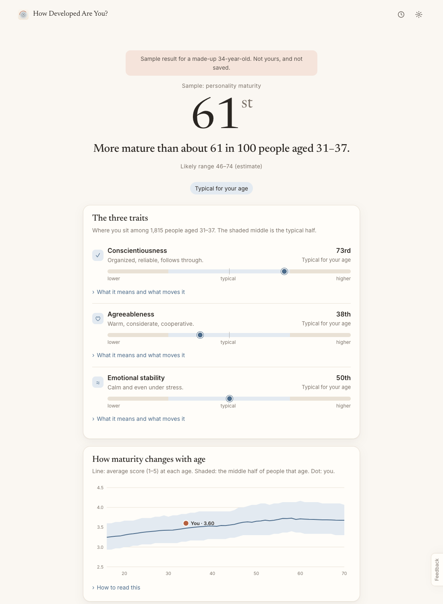
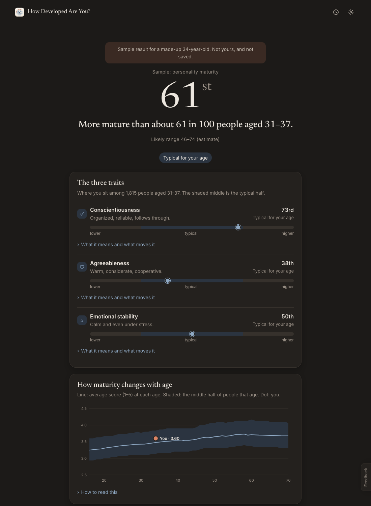

# How Developed Are You?

A 4-minute test of personality maturity: how organized, warm and steady you are **compared with people your own age**. Answers never leave your browser.

  
  

- **30 public-domain statements** ([IPIP](https://ipip.ori.org/new_ipip-50-item-scale.htm)) on the three traits that rise with age: conscientiousness, agreeableness, emotional stability.
- **A percentile among your age peers**, with a likely range, built from 18,175 people in an [open dataset](https://openpsychometrics.org/_rawdata/).
- **Not an age.** We tested that: personality explains 6% of the variance in age, so an honest "you seem 38" would span ~43 years. [Why](docs/SYSTEM-DESIGN.md#what-it-measures-and-what-it-refuses-to)
- Explainers with sources, a share card, retake history, dark mode, keyboard (1–5, ←, ⌘,).

## Links

- **[Take the test](https://amalmehta.com/HowDevelopedAreYou/)**
- [Instructions](docs/INSTRUCTIONS.md): run, test, rebuild norms, manual checklist
- [System design](docs/SYSTEM-DESIGN.md): scoring definitions, privacy, threat model, trade-offs
- [File structure](docs/FILE-STRUCTURE.md)
- [Prompt log](docs/PROMPTS.md)
