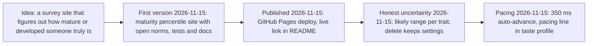
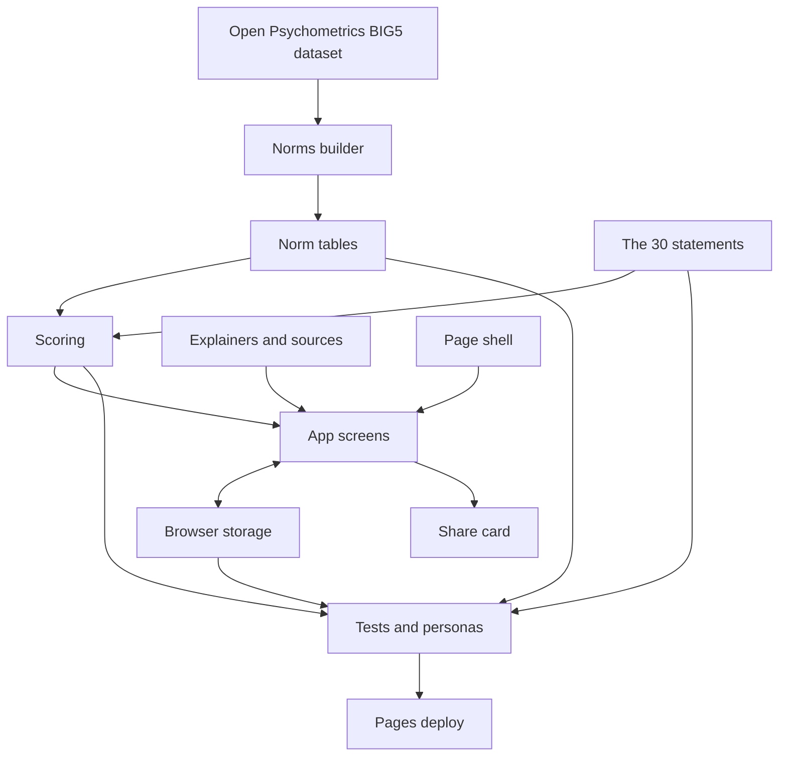
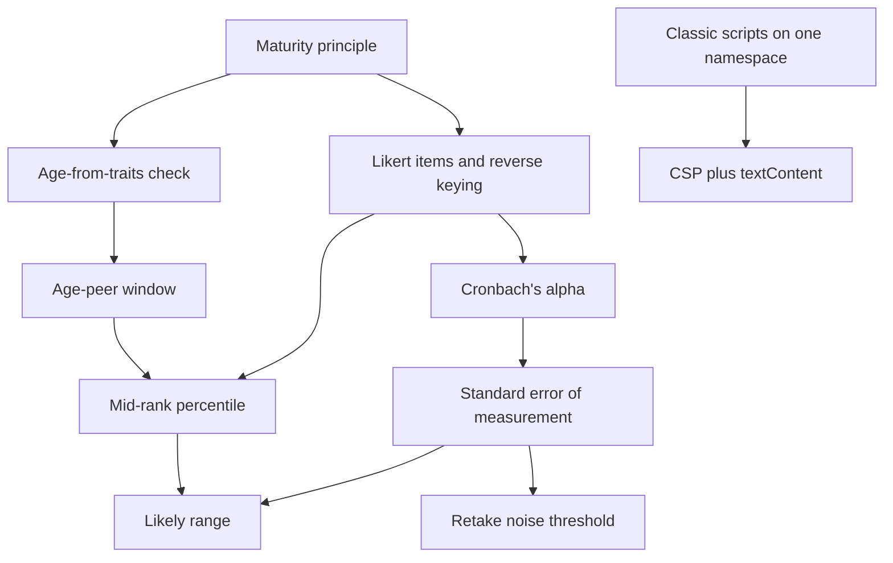

<!-- ProjectForge explainer at 27dc834 -->
# How HowDevelopedAreYou? was built

HowDevelopedAreYou? is a static website. In about four minutes it tells you how mature your personality is compared with people your own age. Anyone curious about that can use it, and nothing they answer leaves the browser. The one idea that makes it work: it measures maturity as three traits that rise with age on average (conscientiousness, agreeableness and emotional stability), and it reports a **percentile among age peers**, not an age. The project tested turning answers into an age and found the result was mostly noise.

## Build history

No decisions were recorded from the build sessions, so the chart shows only the idea and the commits.

- **First version (2026-11-15):** the first commit added the percentile site, the open norms, the tests and the docs.
- **Published (2026-11-15):** the site was deployed to GitHub Pages and the live test was linked. The README was then pointed at the live site.
- **Honest uncertainty (2026-11-15):** each trait now shows a likely range. "Delete all results" now clears saved results without resetting settings.
- **Pacing (2026-11-15):** auto-advance was slowed to 350 ms so the chosen answer stays visible. A matching pacing line was added to the author's taste profile in `HowDevelopedAreYou?.md`.

## Code map

| Part | File | What it does |
|---|---|---|
| Norms builder | `tools/build_norms.py` | Downloads the dataset, cleans it, builds percentile tables for each age, computes reliability, and with `--report` prints the age-prediction checks. |
| Norm tables | `site/norms.js` | Generated file holding `HDAY.norms`: `meta` (sample size, α, SEM) and one table per age from 16 to 70. |
| The 30 statements | `site/items.js` | `HDAY.items`: each statement's id, trait (`C`, `A`, `ES`), reverse-key flag and exact wording. |
| Scoring | `site/scoring.js` | Pure functions: `score` turns answers and age into percentiles, ranges and bands; `curve` gives the average by age for the chart. |
| Explainers and sources | `site/content.js` | `HDAY.content`: band labels, plain-language text for each trait, and citations. |
| Page shell | `site/index.html` | Header, settings dialog, toast, Content-Security-Policy, and the script tags in load order. |
| App screens | `site/app.js` | Intro, one statement per screen, result, history and settings; keyboard; builds every element with `textContent`. |
| Browser storage | `site/storage.js` | Reads and writes history and settings under the `localStorage` key `hday.v1`, and validates everything it reads. |
| Share card | `site/share.js` | Draws a 1200×630 PNG of the result on a canvas. |
| Tests and personas | `tests/scoring.test.js`, `tests/personas.js` | `node --test` checks of items, norms, bands, ranges and storage, plus 12 sample takers. |
| Pages deploy | `.github/workflows/pages.yml` | On every push to `main`, runs the tests, then publishes `site/` to GitHub Pages. |

One mismatch: `docs/SYSTEM-DESIGN.md` gives the interface as `HDAY.score(answers, age, norms)`. In the code it is `HDAY.scoring.score(answers, age, items, norms)` (`site/scoring.js:19`, `:67`).

## Concepts

**Maturity principle**: Psychology finds that, on average, people become more conscientious, agreeable and emotionally stable as they age. The app defines "maturity" as exactly those three traits. That makes the vague idea of being "developed" something the app can measure. A test checks that the norms show the effect: each trait's mean at age 50 is higher than at age 18. Lives in `site/app.js:66` (explanation), `tests/scoring.test.js:31` (check), `docs/SYSTEM-DESIGN.md`.

**Likert items and reverse keying**: A Likert item is a statement you rate from 1 (disagree) to 5 (agree). Some statements point away from the trait, like "I leave my belongings around" for conscientiousness. Those are reverse-keyed: they score 6 − x, so a high number always means more of the trait. Emotional stability is the dataset's neuroticism items flipped. That is why 8 of the 10 `N` items are reversed and only N2 and N4 are not. Without reverse keying, someone who agrees with everything would look average on every trait instead of being caught as inconsistent. Lives in `site/items.js`, `site/scoring.js:27`, and `REVERSE` in `tools/build_norms.py:23`. The test at `tests/scoring.test.js:11` checks the reversed set against the published key.

**Age-peer window**: Your comparison group is everyone in the norm sample within ±3 years of your age. If that gives fewer than 300 people, the window widens one year at a time. Ages above 70 use the age-70 table. The flag `lowConfidence` is set for ages 60 and up, or when the window grew past ±6 years. Young ages have plenty of people, but the sample's median age is 23 and only 272 people were over 60, so older ages need the wider window. Lives in `build` (`tools/build_norms.py:103`) and the age clamp at `site/scoring.js:29`.

**Mid-rank percentile**: Your percentile is the share of peers who scored lower, plus half of those who tied with you. Sums are whole numbers, 10–50 per trait and 30–150 for maturity, so many people tie. Counting ties as half keeps a typical score near 50 instead of pushing it up or down. The builder works out the percentile for every possible sum in advance. Scoring is then a single array lookup: `peer.M[total - 30]`.

$$P(s) = 100 \cdot \frac{B(s) + \tfrac12\,T(s)}{n}$$

Here $B(s)$ is the number of peers scoring below $s$, $T(s)$ the number scoring exactly $s$, and $n$ the number of peers. Lives in `midrank_table` (`tools/build_norms.py:95`) and `site/scoring.js:33`, `:39`.

**Cronbach's alpha**: Alpha (α) is a number from 0 to 1. It measures how consistently a person's answers move together across the items of one scale. It compares the variance of each item with the variance of the total. The app needs it to know how much of a score is noise. From the norm data, α is 0.85 for all 30 items, and 0.81–0.87 for each 10-item trait (`site/norms.js` `meta`).

$$\alpha = \frac{k}{k-1}\left(1 - \frac{\sum_{i=1}^{k} \sigma_i^2}{\sigma_X^2}\right)$$

Here $k$ is the number of items, $\sigma_i^2$ the variance of item $i$, and $\sigma_X^2$ the variance of the summed score. Lives in `reliability` (`tools/build_norms.py:84`).

**Standard error of measurement (SEM)**: SEM is the typical gap between the score someone got and their "true" score. It is computed from alpha. For the 30-item sum it is 6.0 points. For each trait it is about 3 points out of 50.

$$\mathrm{SEM} = \sigma_X \sqrt{1 - \alpha}$$

It reflects how inconsistent answers are within one sitting. It does not capture day-to-day mood. The docstring says this, and the app calls every range "an estimate". Lives in `tools/build_norms.py:91`, stored as `semSum` and `traitSemSum`.

**Likely range**: The likely range is the percentile of your sum minus one SEM, up to the percentile of your sum plus one SEM. Sums are clamped to the valid range first. That covers about a 2-in-3 chance of containing your true percentile. On screen, this is the darker stretch on each trait bar and the "Likely range" line under the headline. Lives in `site/scoring.js:34–43`. Tests check that the range brackets the percentile and that 10-item traits carry more error per point than the 30-item total (`tests/scoring.test.js:57`, `:65`).

**Retake noise threshold**: Two takes by the same person each carry their own error, so they differ by about √2 × SEM (≈ 8.5 sum points) from noise alone. Near the middle of the distribution that is about 20 percentile points; the 95% bound is about 36. The "Since last time" card uses these cut-offs: under 20 is noise, 20–35 is "see if it holds", and over 35 is "likely shifted". Lives in `historyTrend` (`site/app.js:266`). The numbers are explained in `docs/SYSTEM-DESIGN.md`.

**Age-from-traits check**: This is the experiment behind "a percentile, not an age". `report` (`tools/build_norms.py:123`) first fits a least-squares line from the three traits to age; it gives R² = 0.063, so traits explain about 6% of the differences in age. Then, using a seeded split (13,000 people to fit, the rest held out), it does three things:

- It fits each trait's mean against age as a quadratic.
- It assumes trait scores are normally distributed around those means, with one shared covariance.
- For each held-out person, it computes how likely every age from 16 to 70 is.

The 80% span of that likelihood is about 43 years wide. It also measures how many people fall outside the range of age averages altogether. The numbers are in `docs/SYSTEM-DESIGN.md`, and `python3 tools/build_norms.py --report` reproduces them.

**Classic scripts on one namespace**: Every file adds itself to `globalThis.HDAY` and ends with `if (typeof module !== "undefined") module.exports = …`. In the browser, `index.html` loads the files as ordinary `<script>` tags in dependency order: norms, items, scoring, storage, content, share, app. In Node, the tests `require` the same files. The site avoids ES modules so it still works when opened straight from disk (`file://`), where browsers block module imports (`docs/SYSTEM-DESIGN.md`). Lives in every `site/*.js` and `site/index.html:66–72`.

**CSP plus textContent**: The Content-Security-Policy is a rule set that tells the browser what the page may load. Here it allows scripts only from the site itself, styles only from the site and Google Fonts, and no network connections (`connect-src 'none'`) (`site/index.html:6`). The policy also forbids inline `style` attributes. So the DOM helper `el` sets styles one property at a time through `style.setProperty`, and sets all text with `textContent`, never `innerHTML` (`site/app.js:11–24`). Together these stop stored or shared data from injecting markup. The storage layer adds a second guard: `validResult` drops any history entry with the wrong shape or out-of-range numbers (`site/storage.js:14`). The test at `tests/scoring.test.js:110` feeds it `age: ""` and bad JSON.

## One input, start to finish

The input is the built-in sample: a made-up 34-year-old, shown from "See a sample result first →" or `#sample`.

1. **Norms exist before anyone visits.** `load` in `tools/build_norms.py` reads 19,719 rows. It drops 1,543 with an unusable age (outside 16–80) and 1 with a missing answer, which leaves 18,175. It turns each row into three keyed trait sums. `build` gives age 34 a ±3 window (31–37), which holds 1,815 people, so no widening is needed and `lowConfidence` is false. `midrank_table` fills that age's `C`, `A`, `ES` and `M` arrays. `main` writes everything to `site/norms.js`.
2. **Page load.** `site/index.html` loads the scripts. `site/app.js` calls `store.load()` from `site/storage.js`, applies the theme, sees `#sample`, and calls `sample()`.
3. **Answers are built.** `sample` (`site/app.js:124`) wants keyed scores of 4 for conscientiousness, 4 for agreeableness and 3 for stability. It tweaks five items: C5→5, C9→3, A3→2, N3→2, N10→4. It stores `6 − k` for reverse-keyed items, so that keying them again in scoring gives back `k`.
4. **Validation.** `score` (`site/scoring.js:19`) checks that 34 is a whole number from 16 to 99 and that all 30 answers are in 1–5.
5. **Keying and sums.** For each item it adds `x`, or `6 − x` if `rev`. That gives C = 40, A = 38, ES = 30, so the total is 108 and the maturity mean is 108 / 30 = 3.6.
6. **Peer table.** The age key is clamped to 16–70, which leaves 34, so `peer = norms.ages[34]`.
7. **Trait percentiles and ranges.** The trait SEMs round to 3, so each range uses the sum ± 3.
   - Conscientiousness: `peer.C[30]` = 72.6, likely range 59.1–85.8.
   - Agreeableness: `peer.A[28]` = 38.1, range 23.7–55.1.
   - Emotional stability: `peer.ES[20]` = 50.2, range 36.9–62.3.
   - All three fall in the 25–75 "typical" band (`band`).
8. **Maturity percentile.** `peer.M[78]` = 60.7. With SEM 6, the range is `M[72]` to `M[84]`, which is 45.8–73.9. The band is "typical", and the peer average (`mean_M`) is 3.474.
9. **Result screen.** `result` (`site/app.js:138`) shows "61st" and "More mature than about 61 in 100 people aged 31–37". Below that are "Likely range 46–74 (estimate)" and the badge "Typical for your age" from `site/content.js`. A banner marks it as a sample.
10. **Trait bars.** `traitRow` (`site/app.js:191`) draws each meter: the shaded middle half, the likely-range stretch and your dot. It also shows the explainers from `content.traits`.
11. **Age chart.** `ageChart` (`site/app.js:221`) calls `curve` (`site/scoring.js:56`) to get the average and the 25th–75th percentile band for every age 16–70. It draws them as SVG and puts the dot at age 34, score 3.60.
12. **Not saved.** `sample` never touches history. A real taker goes through `finish` (`site/app.js:113`) instead. It calls the same `score`, and if "Save results" is on, it pushes the result into `data.history` and calls `store.save`. `store.save` writes JSON under `hday.v1`. Next visit, `store.load` reads it back through `validResult`. "Save share card" for a real result calls `shareCard` in `site/share.js`, which draws the percentile, peer ages, range and three trait dots onto a canvas and returns a PNG.

## Where this came from

Written from the spec, the decisions (none recorded), the git history and the code as of commit 27dc834 ("Add pacing line to the taste profile").
