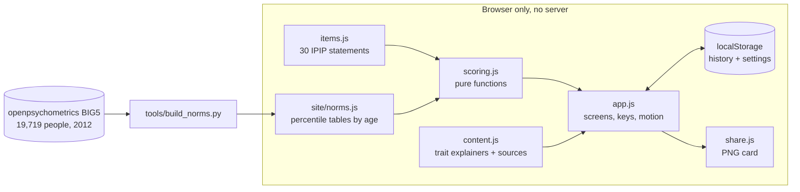

# System Design: How Developed Are You?

A static website that measures **personality maturity**: how conscientious, agreeable and emotionally stable you are compared with **people your own age**. Answers never leave the browser.

## What it measures, and what it refuses to

Psychology's *maturity principle*: on average, people become more conscientious, agreeable and emotionally stable as they age. The app scores those three traits with 30 public-domain IPIP items, then asks "how do you compare with your age peers?".

It deliberately does **not** turn your answers into an age ("you read as 38"). We tested that on 5,175 held-out people from the norm sample:

| Approach | Result | Verdict |
|---|---|---|
| Predict age from the three traits | Traits explain 6% of age variance (R² = 0.063); honest 80% range ≈ 43 years wide; mean error 16 years vs 8 years for always guessing "23" | Mostly noise |
| "Reading age" (the age whose average equals yours) | 64% of people fall outside every age group's average | Undefined for most people |
| **Percentile among age peers** | Well defined for everyone | **Used** |

Reproduce with `python3 tools/build_norms.py --report`.

## Architecture

| Piece | Job | Interface |
|---|---|---|
| `tools/build_norms.py` | Downloads data, cleans it, builds percentile tables, prints the validity report | Writes `site/norms.js` |
| `site/items.js` | The 30 statements, trait and reverse key | `HDAY.items` |
| `site/scoring.js` | Answers → trait means → peer percentiles → band. No DOM. | `HDAY.score(answers, age, norms)` |
| `site/content.js` | Plain-language trait explainers, sources, limits | `HDAY.content` |
| `site/storage.js` | History and settings in localStorage; export/delete | `HDAY.store` |
| `site/share.js` | Draws a share card to a canvas, downloads a PNG | `HDAY.shareCard(result)` |
| `site/app.js` | Screens, keyboard, opening animation, settings, feedback | — |

Classic scripts on a shared `HDAY` namespace (not ES modules) so the site also works when opened straight from disk (`file://`), where browsers block module imports.

## Main flow

1. Intro: enter age (16–99) → Start.
2. 30 statements, one per screen; keys 1–5 or tap; auto-advance after 350 ms (long enough to see your choice light up); Back / ← to revise.
3. Result: maturity percentile among peers + band, three trait bars, a chart of the average by age with your score marked, explainers with sources.
4. Save to history (on by default, can be turned off), share card, retake.

## Scoring (definitions)

- Item answer *x* ∈ {1..5}; reverse-keyed items score 6 − *x*.
- Trait score = mean of its 10 keyed items (1–5). Emotional Stability is the reverse of the dataset's Neuroticism items.
- **Maturity** = mean of the three trait scores (equivalently, the mean of all 30 keyed items).
- **Peers** = norm-sample people aged within ±3 years of you; widened 1 year at a time until n ≥ 300. Ages above 70 use the 70 window.
- **Percentile** = mid-rank: % of peers scoring lower + half of those tied.
- **Bands**: < 25 "less than most peers", 25–75 "typical for your age", > 75 "more than most peers".
- **Low confidence** flag: age ≥ 60, or the peer window had to widen beyond ±6 years.
- **Likely range** (estimate): the percentiles of your 30-item sum ± 1 standard error of measurement. SEM = SD × √(1 − α), with Cronbach's α = 0.85 and SEM = 6 sum points, both computed from the norm data. Roughly a 2-in-3 range; it reflects item inconsistency in one sitting, not day-to-day change.
- **Retake change** (estimate): two takes differ by about √2 × SEM from noise, ≈ 20 percentile points near the middle (1 SD) and ≈ 36 (95%). History labels changes < 20 as noise, 20–35 as "see if it holds", > 35 as "likely real".

## Where data lives

- Norms: a static, derived JS file in the repo (no individual records, only percentile tables).
- User answers and results: this browser's `localStorage` only, key `hday.v1`. No cookies, analytics, server or third party. Fonts load from Google Fonts (this sends your IP to Google, like any web font); the site falls back to system fonts offline.
- Export: JSON download. Delete: "Delete all results" clears history but keeps settings, so an opt-out of saving survives the delete.

## Threat model

| Risk | Mitigation |
|---|---|
| Someone reads your results | Data exists only in your browser profile; anyone using that profile could see it. History can be switched off and deleted. |
| Results leak through URLs, logs or analytics | None exist. The share card is a PNG you choose to send; it holds only scores, no age unless you include it. |
| Injected content (XSS) | No user text is rendered as HTML; all dynamic text set via `textContent`. Strict Content-Security-Policy meta: scripts only from self. |
| Tampered history in localStorage | Parsed defensively, validated, and dropped if malformed. |
| Misleading result | Percentile, not age; bands; low-confidence flag; limits shown on the result page. |

No accounts, so no auth to break. Nothing to change server-side.

## Key decisions and trade-offs

- **Static, no server**: privacy and zero cost, but no norms from our own users and no history across devices.
- **Fixed rules over AI**: reproducible, free, explainable; weakness is self-report flattery (no forced-choice yet).
- **Percentile over age number**: honest, less viral.
- **Norm sample**: one open 2012 online sample (skews young: median age 23; only 272 people aged 61–80). Labelled in the app.

## Testing

- `node --test tests/` — scoring, reverse keys, peer windows, percentiles, bands, edge cases, storage validation.
- `tests/personas.js` — sample takers (typical, all-neutral, all-extreme, age 16, age 85, missing answers) run end to end through scoring.
- `python3 tools/build_norms.py --report` — rebuilds norms and the validity numbers above.
- Manual checklist: `docs/INSTRUCTIONS.md`.

## Scale and what would change

Today: a handful of friends. Static files on GitHub Pages handle any realistic load. If it grows to wanting norms from its own users, it needs a backend with consent, anonymisation and abuse controls (roughly: when the open sample stops being representative of who takes it, or above ~10k takers/month).

## Where it's heading (not built)

Compare with a friend (result codes), forced-choice items against flattery, an agency scale, other languages, a Mac app.
